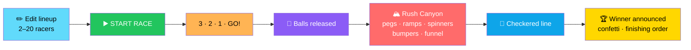
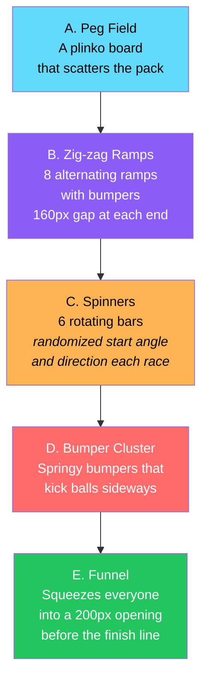
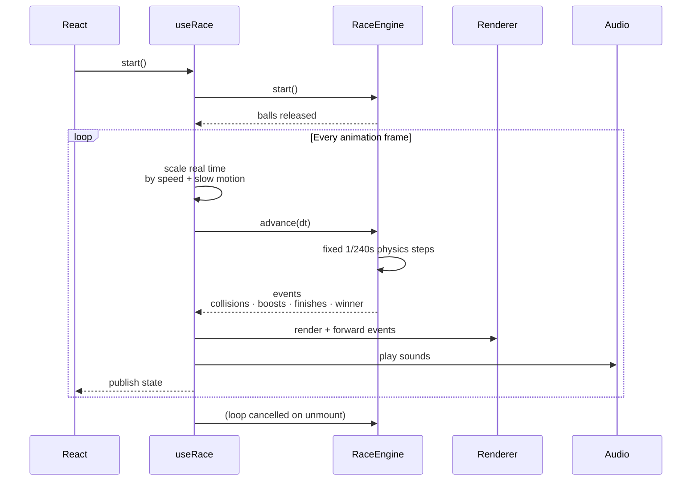

# 🏁 Color Rush: Ball Race

<div align="center">


**Pick your favorites. Start the race. Watch the chaos.**

*An automatic ball-racing game — no steering, just pure physics and chance.*

[🎮 Gameplay](#-gameplay) • [🏁 The Track](#-the-track-rush-canyon) • [✨ Features](#-features) • [🏗️ Architecture](#️-architecture) • [🚀 Install](#-installation)

</div>

---

## 📖 Overview

**Color Rush** is an **automatic ball-racing game**.

> **You never steer anything.**

Add your racers, press **START RACE**, and watch up to **20 colorful balls** tumble down a **5,000-pixel physics canyon** of pegs, ramps, spinning bars, and bumpers.

**The first ball across the checkered line wins.**

### Core Idea

> **Every race is different.**
>
> Starting slots, launch velocities, spinner phases, and random boosts are drawn **fresh from a seeded random generator** — and **nothing about a ball's name, color, or list position can influence the outcome.**

### The Race Flow



---

## 🎮 Gameplay

### 1. Edit the Lineup

In the **Participants** panel — **2 to 20 racers**, any name, any color.

### 2. Start the Race

Press **START RACE**. A **3 · 2 · 1 · GO!** countdown plays, and the balls are released.

### 3. Watch the Pack

- The camera **follows the pack**
- The **gold-outlined ball with the ★ label** is the **current leader**
- A **slim progress bar** on the right edge of the arena shows **every ball on the whole track**

### 4. Photo Finish

> **When two balls fight for the line, the race drops into slow motion with a "CLOSE FINISH!" banner.**

### 5. The Winner

The winner is announced with:

- **Confetti**
- The **full finishing order**
- **Finish times**

**Press RACE AGAIN** for a new race with **fresh random conditions**.

---

## 🏁 The Track — "Rush Canyon"



<div align="center">

| Section | What It Does |
|:-------:|-------------|
| **A. Peg Field** | A **plinko board** that scatters the pack |
| **B. Zig-zag Ramps** | **Eight alternating ramps** with bumpers; balls drop through a **160px gap** at the end of each |
| **C. Spinners** | **Six rotating bars** that fling balls around — their **start angle and direction are randomized every race** |
| **D. Bumper Cluster** | Springy bumpers that **kick balls sideways** |
| **E. Funnel** | Squeezes everyone into a **200px opening** before the finish line |

</div>

### 🔒 Fairness by Construction

> ✅ **Every opening is at least three ball-diameters wide** *(balls shrink as the field grows)* — so **a ball can never be blocked from finishing**.
>
> **A stuck-ball nudge and a 120-second failsafe cover the freak cases.**

---

## ✨ Features

<div align="center">

| 🎱 Automatic Simulation | 👥 Participants |
|:---:|:---:|
| Fully automatic race with **real-time, fixed-step physics** — gravity, drag, friction, restitution, ball-ball and ball-obstacle collisions, rotating obstacles | **2–20 racers** · editable names and colors · **live ball previews** · **duplicate-name and duplicate-color validation** · add / remove / **RESTORE DEFAULTS** |
| **🎮 Controls** | **✨ Visuals** |
| START RACE · PAUSE / RESUME · RESTART · SOUND ON / OFF · **SPEED 1× / 2× / 4×** · **conflicting controls are disabled for the current state** | Glowing balls with **spin markers** and **trails** · **spark bursts** on impact · **flashing bumpers** · **animated spinners** · **finish-line flash** · **confetti** |
| **🏷️ Labels & Standings** | **📸 Photo Finish** |
| **Name labels with automatic overlap avoidance** · live leader chip · live standings | **Slow motion** with a **"PHOTO FINISH!"** tag when the gap is **under 0.15s** |
| **🔊 Synthesized Sound** | **🏆 Results** |
| Collisions · boosts · countdown · victory — **no audio files needed** | Winner · finishing order · **per-ball finish times** · basic stats · **the most recent race is kept for the browser session** |
| **♿ Accessible** | **📱 Responsive** |
| Keyboard-accessible controls · **ARIA labels** · **`prefers-reduced-motion` support** *(no trails, sparks, confetti, slow motion, or camera easing)* | Canvas follows **window resizes** and **pixel-density changes** |
| **⏸️ Smart Pause** | |
| The race **auto-pauses if the tab is hidden** | |

</div>

---

## 🏗️ Architecture

### System Overview

```mermaid
flowchart TB
    subgraph UI["🖥️ React UI"]
        Header["Header"]
        Editor["ParticipantEditor<br/>add · remove · rename<br/>recolor · validation"]
        Preview["BallPreview<br/>glossy CSS ball"]
        Arena["RaceArena<br/>canvas · resize · leader chip<br/>overlays"]
        Controls["RaceControls<br/>start · pause · restart<br/>sound · speed"]
        Countdown["Countdown<br/>3 · 2 · 1 · GO!"]
        Leaderboard["Leaderboard<br/>live standings<br/>final results · last race"]
        Winner["WinnerModal<br/>winner · confetti<br/>finishing order"]
    end

    subgraph HOOK["🪝 useRace Hook"]
        Loop["Single requestAnimationFrame loop<br/>scaled by speed and photo-finish slow motion"]
    end

    subgraph GAME["⚙️ Game (UI-Free)"]
        Engine["RaceEngine<br/>state machine · fixed-step loop<br/>finish detection · results"]
        Ball["Ball<br/>creation · per-ball random traits<br/>launch · boost"]
        Physics["Physics<br/>constants · integration<br/>contact and impulse math"]
        Collision["CollisionSystem<br/>ball vs walls · pegs · ramps · spinners<br/>ball vs ball · events"]
        Track["Track<br/>course layout · world size"]
        Renderer["RaceRenderer<br/>canvas drawing · camera<br/>trails · particles · labels · minimap"]
        Audio["AudioManager<br/>synthesized sounds"]
        Roster["participants<br/>roster rules · defaults<br/>validation"]
        Results["results<br/>statistics · session storage"]
    end

    subgraph UTILS["🧰 Utils"]
        Random["random.ts<br/>seeded PRNG"]
        Format["formatTime.ts"]
    end

    UI --> HOOK
    HOOK --> GAME
    GAME --> UTILS

    style UI fill:#61DAFB,color:#000
    style HOOK fill:#FFB454,color:#000
    style GAME fill:#8B5CF6,color:#fff
    style UTILS fill:#22C55E,color:#fff
```



### 🔄 How It Fits Together



**The single loop is created once and cancelled on unmount — so loops never stack.**

### 📂 File Structure

```text
color-rush/
├── public/
│   └── favicon.svg
│
├── src/
│   ├── components/                      React UI
│   │   ├── Header.tsx                    title + subtitle
│   │   ├── ParticipantEditor.tsx        add / remove / rename / recolor
│   │   │                                 + validation messages
│   │   ├── BallPreview.tsx              glossy CSS ball
│   │   ├── RaceArena.tsx                canvas · resize handling
│   │   │                                 leader chip · overlays
│   │   ├── RaceControls.tsx             start / pause / restart
│   │   │                                 sound / speed
│   │   ├── Countdown.tsx                3, 2, 1, GO!
│   │   ├── Leaderboard.tsx              live standings · final results
│   │   │                                 last race
│   │   └── WinnerModal.tsx              winner · confetti
│   │                                     finishing order · RACE AGAIN
│   │
│   ├── game/                            everything below is UI-free
│   │   ├── RaceEngine.ts                race state machine
│   │   │                                 fixed-step loop
│   │   │                                 finish detection · results
│   │   ├── Ball.ts                      ball creation
│   │   │                                 per-ball random traits
│   │   │                                 launch and boost
│   │   ├── Physics.ts                   constants · integration
│   │   │                                 contact and impulse math
│   │   ├── CollisionSystem.ts           ball vs walls / pegs / ramps / spinners
│   │   │                                 ball vs ball · events
│   │   ├── Track.ts                     the course layout and world size
│   │   ├── RaceRenderer.ts              canvas drawing · camera
│   │   │                                 trails · particles · labels · minimap
│   │   ├── AudioManager.ts              synthesized sounds
│   │   ├── participants.ts              roster rules · defaults · validation
│   │   └── results.ts                   statistics
│   │                                     session storage of the last race
│   │
│   ├── hooks/
│   │   └── useRace.ts                   engine + renderer + audio
│   │                                     + the single animation loop
│   │
│   ├── types/
│   │   └── game.ts                      shared types
│   │
│   ├── utils/
│   │   ├── random.ts                    seeded PRNG
│   │   └── formatTime.ts
│   │
│   ├── styles/
│   │   └── global.css
│   │
│   ├── App.tsx
│   └── main.tsx
│
├── tests/                                vitest suites
│   ├── race-engine.test.ts
│   ├── participants.test.ts
│   └── utils.test.ts
│
├── docs/
│   └── screenshots/                      put your screenshots here
│
├── index.html
├── package.json
├── tsconfig.json
├── vite.config.ts
└── .gitignore
```

### 🧠 Why a Custom Physics Engine?

> **Why not Matter.js?**
>
> **The course is a vertical drop built from circles and line segments.**
>
> **A purpose-built engine keeps the simulation:**
>
> - **Small**
> - **Deterministic for a given seed**
> - **Runnable without a browser**
>
> **…which is what makes the engine unit-testable in Node.**

### Design Principles

<div align="center">

| Principle | Implementation |
|-----------|---------------|
| **🤖 Fully automatic** | **You never steer anything** — the physics decides |
| **🎲 Seeded determinism** | Starting slots, launch velocities, spinner phases, and boosts are drawn from a **seeded PRNG**. **The same seed gives the same race** |
| **⚖️ Fair by construction** | **Nothing about a ball's name, color, or list position can influence the outcome** — all balls draw from **identical distributions** |
| **🚫 Never blocked** | Every opening is **at least three ball-diameters wide** — a ball **can never be blocked from finishing** |
| **⚙️ UI-free game core** | `src/game/` has no React — everything below is testable in Node |
| **🪝 One loop, ever** | `useRace` creates **one** `requestAnimationFrame` loop and cancels it on unmount — **loops never stack** |
| **📸 Real photo finish** | A gap under **0.15s** triggers **slow motion** and a **"PHOTO FINISH!"** tag |
| **♿ Reduced motion respected** | **No trails, sparks, confetti, slow motion, or camera easing** when the OS asks for less |
| **🔄 Auto-pause on hidden tab** | The race pauses when the tab is hidden |
| **🔊 No audio files** | Every sound is **synthesized with WebAudio** |

</div>

---

## 🛠️ Technologies

<div align="center">

| Library | Role |
|---------|------|
| **React 18 + TypeScript** | The interface |
| **Vite 5** | Dev server and production builds |
| **Canvas 2D** | Rendering |
| **Custom physics engine** | Circle / capsule collisions, rotating obstacles, seeded PRNG — **dependency-free** |
| **WebAudio** | Synthesized sound |
| **Vitest** | Tests |

</div>

---

## 🚀 Installation

### Requirements

- **Node.js 18 or newer**
- **npm**

### Install

```bash
cd color-rush
npm install
```

---

## 🛠️ Development and Production

```bash
npm run dev        # start the dev server (http://localhost:5173)
npm run build      # type-check and build to dist/
npm run preview    # serve the production build locally
npm run typecheck  # TypeScript only
```

---

## 🧪 Tests

```bash
npm test           # run the whole suite once
npm run test:watch # watch mode
```

### What the Tests Cover

<div align="center">

| Test File | Coverage |
|-----------|:--------:|
| **`race-engine.test.ts`** | Races with **2, 5, 10, and 20 balls** · nothing moves before `start()` · every ball moves after the start · **winner detected correctly and results ordered** · balls never leave the arena · **same seed gives the same race** · engine stops completely after the race ends · restart resets everything · **statistical fairness check across 240 races** |
| **`participants.test.ts`** | Defaults · add / remove limits *(2–20)* · duplicate and invalid names and colors · sanitizing |
| **`utils.test.ts`** | Time formatting and the seeded random helpers |

</div>

### ⚠️ What Tests Don't Cover

> **Pause / resume lives in the React hook** *(the loop simply stops stepping the engine)* — **so verify it manually**:
>
> 1. Press **PAUSE** mid-race
> 2. The balls **freeze** and a **PAUSED overlay** appears
> 3. **RESUME** continues from the same state

---

## 🎨 Customizing

### 🎱 Ball Names and Colors

**In the app:** edit the **Participants** panel — **names up to 20 characters**, any color picker value.

**Defaults:**

- Edit **`DEFAULT_ROSTER`** in `src/game/participants.ts`
- Colors added automatically come from **`COLOR_PALETTE`**, extra names from **`EXTRA_NAMES`** in the same file
- Limits: **`MIN_PARTICIPANTS`** / **`MAX_PARTICIPANTS`** in `participants.ts` and **`MIN_BALLS`** / **`MAX_BALLS`** in `RaceEngine.ts`
- ⚠️ **Keep them in sync** — and note the track is **tuned for up to 20 balls**

### 🏁 The Track

**Open `src/game/Track.ts`.**

Pegs, bumpers, ramps, and spinners are added with the small helper functions:

- `peg()`
- `bumper()`
- `ramp()`
- `spinner()`

**The five sections are labelled A to E.**

World constants are at the top of the file:

- `WORLD_WIDTH`
- `FINISH_Y`
- `FLOOR_Y`
- `WORLD_HEIGHT`

#### ⚠️ Rules to Keep Every Race Finishable

- **Keep every gap at least 3 × the largest ball diameter** *(≈ 110px for the biggest balls)*
- **Keep inclined surfaces at least ~8°** so balls don't stall
- **Keep `FINISH_Y` above `FLOOR_Y`**
- **Keep `FLOOR_Y` below `WORLD_HEIGHT`**

> ✅ **After changes, run `npm test`** — the suite simulates full races and **fails if a ball cannot finish**.

### ⚙️ The Physics

**Open `src/game/Physics.ts`.**

<div align="center">

| Constant | Effect |
|----------|--------|
| **`GRAVITY`** | Overall speed of the race — **the main knob for race length** |
| **`AIR_DRAG`** | Terminal-velocity softening |
| **`ROLL_FRICTION`** | How much balls slow down while rolling on ramps |
| **`PAIR_RESTITUTION`** · **`WALL_RESTITUTION`** · **`BUMPER_RESTITUTION`** · **`BUMPER_KICK`** | Bounciness of ball-ball, walls, and bumpers |
| **`REST_THRESHOLD`** | Below this impact speed, balls stop bouncing and settle |
| **`FIXED_DT`** | Physics step — **smaller is more accurate and more expensive** |

</div>

**Randomness lives in `src/game/Ball.ts`:**

- `createBall`
- `launchBall`
- `boostBall`

**What it controls:**

- Per-ball restitution and drag
- The initial velocity
- The boost frequency and strength

> ✅ **All balls draw from identical distributions.**

**Race pacing at the end** is controlled by **`FINISH_GRACE`** and **`MAX_RACE_TIME`** in `RaceEngine.ts`.

---

## 🔧 Troubleshooting

<div align="center">

| Problem | Fix |
|---------|-----|
| **`npm install` fails or `vite` is not found** | Use **Node.js 18+** *(`node -v`)*, delete `node_modules` and `package-lock.json`, run `npm install` again |
| **Port 5173 already in use** | `npm run dev -- --port 3000` |
| **Blank page** | Open the browser console. A **missing-canvas** message means the browser lacks **Canvas 2D** support — use a current Chrome, Firefox, Safari, or Edge |
| **No sound** | Click **SOUND** to make sure it says **ON**, and start the race with a click *(browsers block audio until you interact)*. Check the device is not muted |
| **Choppy animation** | Lower the browser zoom or window size, close heavy tabs, or use **1× speed**. **The simulation is fixed-step, so race results do not depend on frame rate** |
| **Trails, confetti, or slow motion are missing** | Your OS has **"reduce motion"** enabled. **That is intentional** |
| **START RACE is disabled** | A participant has an **empty, too-long, or duplicate name**, or a **duplicate color**. Fix the highlighted rows. After a race, press **RESTART** or **RACE AGAIN** |
| **Lineup can't be edited** | Editing is **locked while a race is running or showing results**. Press **RESTART** |
| **`npm test` can't find vitest** | Run `npm install` first *(vitest is a dev dependency)* |

</div>

---

## 📸 Screenshots

> ⚠️ **Screenshots are not committed.**

**To add yours:**

1. Run the game *(`npm run dev`)* and capture the **setup screen**, a **mid-race moment**, and the **winner modal**
2. Save them in **`docs/screenshots/`** — e.g. `setup.png`, `race.png`, `winner.png`
3. Reference them in this README:

```md


```

---

## 🗺️ Roadmap

### ✅ Current

- [x] Fully automatic race simulation with real-time fixed-step physics
- [x] Gravity, drag, friction, restitution, ball-ball and ball-obstacle collisions
- [x] Rotating obstacles with randomized start angle and direction
- [x] 2–20 participants with editable names and colors
- [x] Live ball previews
- [x] Duplicate-name and duplicate-color validation
- [x] Add, remove, and RESTORE DEFAULTS
- [x] Start, pause, resume, restart controls
- [x] Sound on / off
- [x] Speed 1× / 2× / 4×
- [x] Conflicting controls disabled for the current state
- [x] Glowing balls with spin markers and trails
- [x] Spark bursts on impact
- [x] Flashing bumpers and animated spinners
- [x] Finish-line flash and confetti
- [x] Name labels with automatic overlap avoidance
- [x] Live leader chip and live standings
- [x] Photo-finish slow motion and "PHOTO FINISH!" tag under 0.15s
- [x] Synthesized sound effects — collisions, boosts, countdown, victory
- [x] Results with winner, finishing order, per-ball finish times, and stats
- [x] Most recent race kept for the browser session
- [x] Responsive layout
- [x] Keyboard-accessible controls with ARIA labels
- [x] `prefers-reduced-motion` support
- [x] Auto-pause on hidden tab
- [x] Canvas follows window resize and pixel-density changes
- [x] Custom dependency-free physics engine
- [x] Seeded deterministic PRNG
- [x] **Fair by construction** — name, color, and list position cannot influence the outcome
- [x] **Every opening at least three ball-diameters wide** — no ball can be blocked
- [x] Stuck-ball nudge and 120-second failsafe
- [x] Race engine testable headlessly in Node
- [x] Vitest suite covering race engine, participants, and utils
- [x] **Statistical fairness check across 240 races**
- [x] README with troubleshooting, customization, and extend guidance

### 🔜 Future Ideas

- [ ] **Committed screenshots** — setup, mid-race, and winner
- [ ] **End-to-end tests** — for pause / resume, which is verified manually today
- [ ] **Additional track sections** — beyond Rush Canyon
- [ ] **Tournament mode** — multiple races with cumulative standings
- [ ] **Custom track editor** — visual peg, ramp, and spinner placement
- [ ] **Replay system** — watch a race again by seed
- [ ] **Shareable seed URLs** — the same course for everyone
- [ ] **Additional sound packs** — synthesized variants per theme
- [ ] **Localization** — bilingual UI
- [ ] **Accessibility audit** — screen reader improvements for live standings

---

## 🤝 Contributing

Contributions are welcome. Please:

1. Fork the repository
2. **Keep the game core UI-free** — everything in `src/game/` must be testable in Node
3. **Never let name, color, or list position influence the outcome** — fairness is the point
4. **Preserve the seeded determinism** — the same seed must give the same race
5. **Keep every opening at least three ball-diameters wide** — a ball must never be blocked
6. **Run `npm test` after any track or physics change** — the suite fails if a ball cannot finish
7. **Keep the single animation loop** — loops must never stack
8. **Keep reduced-motion support intact** — trails, sparks, confetti, slow motion, and camera easing must disable
9. **Preserve auto-pause** on hidden tabs
10. Submit a Pull Request

### Guidelines

- **Never introduce a ball-specific advantage** — random traits must draw from identical distributions
- **Never bypass the fixed timestep** — race results must be frame-rate independent
- **Never ship a track that fails the test suite**
- **Never remove reduced-motion handling** without an equivalent alternative
- **Never claim a race is deterministic** unless the same seed produces the same result

---

## 📜 License

**MIT. Do whatever you like with it.**

---

## 🙏 Acknowledgments

- **Canvas 2D** — for making a full racing simulation possible without a 3D engine
- **WebAudio** — for a game with zero audio files
- **Vitest** — for tests that run in a second
- **Every marble run that ever made you cheer for a color** — this one's for you

---

<div align="center">

### 🏁 PICK. START. WATCH. WIN.

**Pick your favorites. Start the race. Watch the chaos.**

**Fair by construction. Deterministic by seed. Custom physics. Zero assets.**

<br>

⭐ If you enjoyed the race, consider giving it a star.

<br>

[⬆ Back to Top](#-color-rush-ball-race)

</div>
